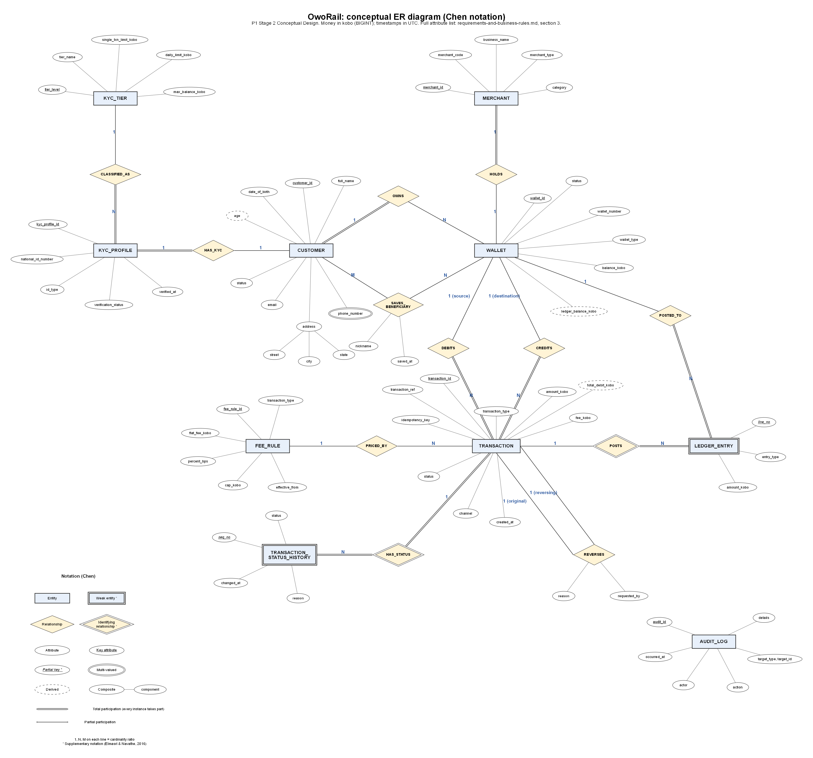

# P1: Requirements Analysis, Business Rules and Conceptual Design

This document covers the first two **stages of database design** (Course §1.1.2):

- **Stage 1: Requirements Analysis.** Purpose, users, entities and attributes, business rules, functional and non-functional requirements (sections 1–6).
- **Stage 2: Conceptual Design.** ER model and ER diagram in Chen notation, with entities, attributes, relationships, cardinalities and keys (sections 7–9).

Logical Design (relational schema, normalisation) follows in [schema.md](schema.md) and [normalisation.md](normalisation.md); Physical Design in `sql/`.

---

## 1. Purpose and scope

The OwoRail database is the **system of record for customer wallets and money movement**. It must guarantee that money is never created, lost or posted twice, and that every wallet balance can be proved from a **double-entry ledger**.

**In scope:**
- customers and their identity (KYC)
- wallets
- merchants and billers
- fees
- transactions and their ledger postings
- status history
- reversals
- the audit trail

**Out of scope:**
- the mobile app and the external bank and biller integrations themselves (they appear only as transaction types and system wallets)
- authentication of end users
- staff identity management: staff are referenced by username from the company's identity provider

## 2. Users and their data needs

| User | Needs to… | Access (designed in Physical Design, M4) |
|---|---|---|
| Customers (mobile app) | onboard, transfer, pay, view statements | only through the payments application, never directly |
| Merchants | receive payments, view settlement reports | through the application and reports |
| Customer-support agents | find a customer by phone or email; view wallets and transactions | read-only; **no KYC identity data** |
| Compliance / KYC analysts | verify identity, change KYC tier and status | read/write on KYC data |
| Fraud analysts | run velocity checks across transactions | read-only on transactions and wallets |
| Finance / reconciliation officers | reconcile balances against the ledger; settle merchants | read-only on financial data |
| Internal auditors | review everything, including the audit log | read-only on all tables |
| Payments application (service account) | execute every customer-facing operation | read/write on operational tables; no DDL |
| DBA | manage the schema, roles, backups and performance | owner |

## 3. Entities and attributes (data dictionary)

Attribute kinds use the Chen terms from the course: **key**, simple, **composite**, **multi-valued**, **derived**. "Stored" means the value is kept in the database; derived attributes are computed when needed. Money is always integer **kobo** (₦1 = 100 kobo); timestamps are UTC.

### CUSTOMER
| Attribute | Kind | Domain / notes | BR |
|---|---|---|---|
| customer_id | key | system-generated integer | BR-01 |
| full_name | simple | text, required | BR-01 |
| email | simple | text, unique, required | BR-01 |
| date_of_birth | simple | date; customer at least 18 at onboarding | BR-01 |
| age | **derived** | computed from date_of_birth and today's date; never stored (it would go stale) | BR-01 |
| address | **composite** | street, city, state (Nigerian state) | BR-01 |
| phone_number | **multi-valued** | one or more per customer; each number belongs to only one customer | BR-02 |
| status | simple | ACTIVE, SUSPENDED, CLOSED | BR-01 |
| created_at | simple | onboarding time | BR-01 |

### KYC_PROFILE
| Attribute | Kind | Domain / notes | BR |
|---|---|---|---|
| kyc_profile_id | key | system-generated integer | BR-03 |
| id_type | simple | BVN or NIN | BR-03 |
| national_id_number | simple | 11 digits, unique; **synthetic, prefixed `999`** | BR-03 |
| verification_status | simple | PENDING, VERIFIED, REJECTED | BR-03 |
| verified_at, verified_by | simple | set when verified; verified_by is a staff username | BR-03 |

### KYC_TIER
| Attribute | Kind | Domain / notes | BR |
|---|---|---|---|
| tier_level | key | 1, 2 or 3 | BR-04 |
| tier_name | simple | e.g. "Tier 1: basic" | BR-04 |
| single_txn_limit_kobo, daily_limit_kobo, max_balance_kobo | simple | positive kobo amounts; max_balance may be unlimited | BR-04 |

### WALLET
| Attribute | Kind | Domain / notes | BR |
|---|---|---|---|
| wallet_id | key | system-generated integer | BR-05 |
| wallet_number | simple | 10 digits, unique (the number customers type when sending money) | BR-05 |
| wallet_type | simple | CUSTOMER, MERCHANT, SYSTEM | BR-05, BR-06 |
| currency | simple | NGN only | BR-05 |
| balance_kobo | simple (stored) | cached current balance; see BR-14 | BR-07, BR-14 |
| ledger_balance_kobo | **derived** | Σ credits − Σ debits of the wallet's ledger entries | BR-14 |
| status | simple | ACTIVE, FROZEN, CLOSED | BR-05 |
| system_purpose | simple | FEES, SETTLEMENT, SUSPENSE (SYSTEM wallets only) | BR-06 |
| created_at | simple | | BR-05 |

### MERCHANT
| Attribute | Kind | Domain / notes | BR |
|---|---|---|---|
| merchant_id | key | system-generated integer | BR-09 |
| merchant_code | simple | unique business code, e.g. `MRC00042` | BR-09 |
| business_name | simple | required | BR-09 |
| merchant_type | simple | MERCHANT or BILLER | BR-09 |
| category | simple | e.g. RETAIL, FOOD, TRANSPORT; billers: AIRTIME, ELECTRICITY, CABLE_TV | BR-09 |
| status, created_at | simple | ACTIVE, SUSPENDED | BR-09 |

### FEE_RULE
| Attribute | Kind | Domain / notes | BR |
|---|---|---|---|
| fee_rule_id | key | system-generated integer | BR-12 |
| transaction_type | simple | the type the rule prices | BR-12 |
| min_amount_kobo, max_amount_kobo | simple | amount band the rule applies to | BR-12 |
| flat_fee_kobo | simple | ≥ 0 | BR-12 |
| percent_bps | simple | percentage in basis points (1 bps = 0.01 %), ≥ 0 | BR-12 |
| cap_kobo | simple | optional maximum fee | BR-12 |
| effective_from, effective_to | simple | validity period; effective_to empty = current | BR-12 |

### TRANSACTION
| Attribute | Kind | Domain / notes | BR |
|---|---|---|---|
| transaction_id | key | system-generated integer | BR-10 |
| transaction_ref | simple | unique human-readable reference shown to customers | BR-10 |
| idempotency_key | simple | unique client-supplied key | BR-11 |
| transaction_type | simple | WALLET_FUNDING, TRANSFER, MERCHANT_PAYMENT, BILL_PAYMENT, REVERSAL | BR-10 |
| amount_kobo | simple | > 0 | BR-10 |
| fee_kobo | simple (stored) | ≥ 0; snapshot of the fee charged at posting time | BR-12 |
| total_debit_kobo | **derived** | amount_kobo + fee_kobo | BR-12 |
| status | simple (stored) | PENDING, SUCCESSFUL, FAILED, REVERSED; current status | BR-10, BR-15 |
| channel | simple | APP, USSD, WEB | BR-10 |
| bill_reference | simple | meter, smartcard or phone number; BILL_PAYMENT only | BR-10 |
| narration | simple | optional free text | BR-10 |
| created_at | simple | request time; also the posting time of its ledger entries | BR-10 |

### LEDGER_ENTRY (weak entity of TRANSACTION)
| Attribute | Kind | Domain / notes | BR |
|---|---|---|---|
| line_no | **partial key** | 1, 2, 3… within its transaction; full identifier = (transaction, line_no) | BR-13 |
| entry_type | simple | DEBIT or CREDIT | BR-13 |
| amount_kobo | simple | > 0 | BR-13 |

A ledger entry has no timestamp of its own. It is posted at its transaction's `created_at`, and repeating that value per line would make it depend on only part of the identifier (a partial dependency, which breaks 2NF; see normalisation.md).

### TRANSACTION_STATUS_HISTORY (weak entity of TRANSACTION)
| Attribute | Kind | Domain / notes | BR |
|---|---|---|---|
| seq_no | **partial key** | 1, 2, 3… within its transaction | BR-15 |
| status | simple | the status entered | BR-15 |
| changed_at | simple | | BR-15 |
| reason | simple | optional explanation | BR-15 |

### AUDIT_LOG
| Attribute | Kind | Domain / notes | BR |
|---|---|---|---|
| audit_id | key | system-generated integer | BR-17 |
| occurred_at | simple | | BR-17 |
| actor | simple | database role or staff username | BR-17 |
| action | simple | e.g. KYC_VERIFIED, WALLET_FROZEN, TXN_REVERSED | BR-17 |
| target_type, target_id | simple | the affected record (any table) | BR-17 |
| details | simple | structured detail (JSON) | BR-17 |

### Relationship attributes
| Relationship | Attribute | Notes | BR |
|---|---|---|---|
| SAVES_BENEFICIARY | nickname, saved_at | name the customer gave the saved wallet | BR-08 |
| REVERSES | reason, requested_by | why the transaction was reversed and by whom | BR-16 |

## 4. Business rules

| ID | Business rule |
|---|---|
| **BR-01** | Each customer has a unique customer ID and a unique email address, a full name, a date of birth and one residential address (street, city, state). A customer must be at least 18 years old when onboarded. Status is ACTIVE, SUSPENDED or CLOSED. |
| **BR-02** | A customer registers one or more phone numbers. A phone number is the login identifier, so it can belong to only one customer. |
| **BR-03** | A customer has at most one KYC profile, and a KYC profile belongs to exactly one customer. It records the identity type (BVN or NIN), a unique national identity number and a verification status (PENDING, VERIFIED, REJECTED). |
| **BR-04** | Every KYC profile is classified into exactly one KYC tier (1, 2 or 3). The tier, not the individual profile, defines the single-transaction limit, daily limit and maximum wallet balance. |
| **BR-05** | Every wallet has a unique wallet ID and a unique 10-digit wallet number, holds naira (NGN) only, has a type (CUSTOMER, MERCHANT, SYSTEM) and a status (ACTIVE, FROZEN, CLOSED). A FROZEN or CLOSED wallet cannot send or receive money. |
| **BR-06** | A CUSTOMER wallet is owned by exactly one customer; a MERCHANT wallet is held by exactly one merchant; a SYSTEM wallet (purpose FEES, SETTLEMENT or SUSPENSE) has no owner. A customer gets a wallet at onboarding and may own several; a merchant has exactly one settlement wallet. |
| **BR-07** | Money is stored as integer kobo. A customer or merchant wallet balance can never be negative. Only SYSTEM wallets may be negative: the settlement wallet represents money held at partner banks. |
| **BR-08** | A customer may save any number of wallets as beneficiaries, each with a nickname, and a wallet may be saved by many customers. A customer cannot save the same wallet twice. |
| **BR-09** | Each merchant has a unique merchant code, a business name, a type (MERCHANT or BILLER), a category and a status. Billers (airtime, electricity, cable TV providers) are merchants of type BILLER. |
| **BR-10** | Every transaction has a unique reference, a type (WALLET_FUNDING, TRANSFER, MERCHANT_PAYMENT, BILL_PAYMENT, REVERSAL), a positive amount, a channel (APP, USSD, WEB), a source wallet and a different destination wallet, and a status (PENDING, SUCCESSFUL, FAILED, REVERSED). A bill payment records the customer's bill reference (meter, smartcard or phone number). |
| **BR-11** | Every transaction request carries a client-generated **idempotency key**, and a key can be used by only one transaction. A retried request with the same key returns the original transaction instead of posting the money again. |
| **BR-12** | Fees are defined by fee rules per transaction type and amount band: a flat fee plus a percentage (in basis points), optionally capped, valid between two dates. The fee charged is recorded on the transaction when it is posted, together with the rule used, so later rule changes never alter past transactions. Fees are never negative. |
| **BR-13** | Every posted transaction (SUCCESSFUL or later REVERSED) has at least two ledger entries, each a DEBIT or CREDIT of a positive amount to one wallet, and its **total debits equal its total credits**. A FAILED transaction has no ledger entries. Ledger entries are never updated or deleted. |
| **BR-14** | A wallet's stored balance must always equal its ledger balance (credits minus debits). This is checked by a daily reconciliation. |
| **BR-15** | Every status change of a transaction is recorded, in order, with time and reason. A transaction's current status equals its latest status-history entry. |
| **BR-16** | Only a SUCCESSFUL transaction can be reversed, and at most once. A reversal is a new REVERSAL transaction that posts compensating entries (amount and fee returned), and the original becomes REVERSED. The reversal records a reason and who requested it. |
| **BR-17** | Security-relevant actions (KYC changes, wallet freezes, reversals, privilege changes) are written to an append-only audit log with actor, action, target and time. Audit records are never updated or deleted. |
| **BR-18** | Access follows least privilege. Support staff read customers, wallets and transactions but never KYC identity data. Auditors read everything, including the audit log. Only the payments application writes financial data. |

## 5. Functional requirements

| ID | Requirement | Key operation (case study §1.5) | BRs |
|---|---|---|---|
| FR-01 | Onboard a customer with phone numbers and address, and open a CUSTOMER wallet | 1 | BR-01, 02, 05, 06 |
| FR-02 | Record and verify KYC; assign a KYC tier | 1 | BR-03, 04 |
| FR-03 | Fund a wallet from a partner bank (WALLET_FUNDING) | 2 | BR-07, 10, 13 |
| FR-04 | Transfer funds between wallets, charging the applicable fee | 2, 4 | BR-07, 10–14 |
| FR-05 | Pay a merchant or a biller (with bill reference) | 3, 4 | BR-09, 10, 12, 13 |
| FR-06 | Reverse a successful transaction that failed downstream or was disputed | 5 | BR-16, 13, 15 |
| FR-07 | Produce a wallet statement for a date range, newest first | 6 | BR-13 |
| FR-08 | Reconcile every wallet's stored balance against the ledger | 7 | BR-14 |
| FR-09 | Flag wallets with unusually many outgoing transactions in a time window (velocity check) | 8 | BR-10 |
| FR-10 | Produce a monthly settlement report per merchant | 9 | BR-09, 10 |
| FR-11 | Save, list and remove beneficiaries | 2 | BR-08 |
| FR-12 | Record an audit event for every security-relevant action | all | BR-17 |

## 6. Non-functional requirements

| ID | Category | Requirement |
|---|---|---|
| NFR-01 | Integrity | All money movement is atomic and consistent (ACID); ledger balanced per transaction; no negative customer balances. |
| NFR-02 | Concurrency | Concurrent transfers must not lose updates or deadlock-cascade; duplicate requests must not double-post (P3). |
| NFR-03 | Performance | At about 1 million transactions: phone lookup and first statement page in milliseconds; reports in seconds (measured in P2). |
| NFR-04 | Security | Least-privilege roles; KYC identity data separated from operational data; parameterised queries only (Course §3.2.2). |
| NFR-05 | Privacy | Data minimisation and privacy by design (NDPA 2023, Course Session 6); this portfolio uses synthetic data only. |
| NFR-06 | Auditability | Append-only audit log; immutable ledger; full status history. |
| NFR-07 | Time and money representation | Timestamps in UTC (`timestamptz`); money in integer kobo, never floating point. |
| NFR-08 | Availability and scalability | A design path to replication and sharding (P5). |
| NFR-09 | Recoverability | Daily backups with point-in-time recovery (design statement; out of scope to implement). |

---

## 7. Conceptual design (Stage 2): ER diagram

Source: [erd/erd-chen.dot](erd/erd-chen.dot) (Graphviz), rendered to [SVG](erd/erd-chen.svg) and [PNG](erd/erd-chen.png). Render with `dot -Tsvg erd-chen.dot -o erd-chen.svg` from the `erd/` folder (render log: [evidence/m2_erd_render.txt](evidence/m2_erd_render.txt)).

**Notation** (course Chen notation, Session 1):
- entity = rectangle
- attribute = ellipse
- key attribute = underlined
- multi-valued attribute = double ellipse
- derived attribute = dashed ellipse
- composite attribute = ellipse joined to its component ellipses
- relationship = diamond
- each line from an entity to a relationship is labelled with the cardinality ratio (1, N or M)

**Supplementary notation** (Elmasri & Navathe, 2016, ch. 3; not in the course's symbol table):
- **weak entity** = double rectangle
- **identifying relationship** = double diamond
- **partial key** = underlined italic (Elmasri & Navathe use a dashed underline, which Graphviz cannot draw)
- **total participation** = double line

**ER features required by the brief:**

| Feature | Where |
|---|---|
| Composite attribute | CUSTOMER.address (street, city, state) |
| Multi-valued attribute | CUSTOMER.phone_number |
| Derived attributes | CUSTOMER.age; WALLET.ledger_balance_kobo; TRANSACTION.total_debit_kobo |
| 1:1 relationship | CUSTOMER HAS_KYC KYC_PROFILE; MERCHANT HOLDS WALLET; TRANSACTION REVERSES TRANSACTION |
| 1:N relationship | CUSTOMER OWNS WALLET; KYC_TIER CLASSIFIED_AS KYC_PROFILE; WALLET DEBITS / CREDITS TRANSACTION; and others |
| M:N relationship | CUSTOMER SAVES_BENEFICIARY WALLET (with attributes nickname, saved_at) |
| Recursive (unary) relationship | TRANSACTION REVERSES TRANSACTION, with roles *original* and *reversing* |
| Weak entities | LEDGER_ENTRY and TRANSACTION_STATUS_HISTORY, identified through TRANSACTION |

## 8. Relationships, cardinality and participation

| Relationship | Entities (cardinality) | Participation | Meaning | BR |
|---|---|---|---|---|
| HAS_KYC | CUSTOMER 1 : 1 KYC_PROFILE | customer partial (KYC may come later); KYC profile **total** | a customer has at most one KYC profile | BR-03 |
| CLASSIFIED_AS | KYC_TIER 1 : N KYC_PROFILE | profile **total**; tier partial | each profile is in exactly one tier | BR-04 |
| OWNS | CUSTOMER 1 : N WALLET | customer **total** (wallet opened at onboarding); wallet partial (merchant/system wallets) | a customer owns one or more wallets | BR-06 |
| HOLDS | MERCHANT 1 : 1 WALLET | merchant **total**; wallet partial | a merchant has exactly one settlement wallet | BR-06 |
| SAVES_BENEFICIARY | CUSTOMER M : N WALLET | both partial | saved beneficiaries with nicknames | BR-08 |
| DEBITS | WALLET 1 : N TRANSACTION | transaction **total** (role: source) | money leaves the source wallet | BR-10 |
| CREDITS | WALLET 1 : N TRANSACTION | transaction **total** (role: destination) | money arrives in the destination wallet | BR-10 |
| PRICED_BY | FEE_RULE 1 : N TRANSACTION | both partial (fee-free transactions have no rule) | the rule used to compute the fee | BR-12 |
| POSTS *(identifying)* | TRANSACTION 1 : N LEDGER_ENTRY | ledger entry **total**; transaction partial (FAILED has none) | double-entry lines of a transaction | BR-13 |
| POSTED_TO | WALLET 1 : N LEDGER_ENTRY | ledger entry **total** | the wallet each line debits or credits | BR-13, BR-14 |
| HAS_STATUS *(identifying)* | TRANSACTION 1 : N STATUS_HISTORY | both **total** (every transaction starts with an entry) | ordered status changes | BR-15 |
| REVERSES *(recursive)* | TRANSACTION (original) 1 : 1 TRANSACTION (reversing) | both partial | a reversal undoes exactly one original, at most once | BR-16 |

AUDIT_LOG deliberately has **no relationships**. Its target is a polymorphic reference (`target_type`, `target_id`), so an audit record can describe any table and never blocks a change to the record it describes (BR-17).

## 9. Traceability: every ERD element to a business rule

| ERD element | Type | Business rules |
|---|---|---|
| CUSTOMER (incl. address, age) | entity | BR-01 |
| phone_number | multi-valued attribute | BR-02 |
| KYC_PROFILE, HAS_KYC | entity, relationship | BR-03 |
| KYC_TIER, CLASSIFIED_AS | entity, relationship | BR-04 |
| WALLET (incl. ledger_balance_kobo) | entity | BR-05, BR-07, BR-14 |
| OWNS, HOLDS | relationships | BR-06 |
| MERCHANT | entity | BR-09 |
| SAVES_BENEFICIARY | M:N relationship | BR-08 |
| TRANSACTION (incl. total_debit_kobo) | entity | BR-10, BR-11, BR-12 |
| DEBITS, CREDITS | relationships | BR-10 |
| FEE_RULE, PRICED_BY | entity, relationship | BR-12 |
| LEDGER_ENTRY, POSTS, POSTED_TO | weak entity, relationships | BR-13, BR-14 |
| TRANSACTION_STATUS_HISTORY, HAS_STATUS | weak entity, relationship | BR-15 |
| REVERSES | recursive relationship | BR-16 |
| AUDIT_LOG | entity | BR-17 |
| (access roles, Physical Design) | not an ERD element | BR-18 |

**Check:** all 10 entities and 12 relationships trace to at least one rule, and every rule BR-01 to BR-17 appears in the ERD. BR-18 is enforced by database roles in Physical Design (M4), not by the data model.

## 10. Design decisions and assumptions

1. **Billers are merchants** (`merchant_type = BILLER`). Billers and merchants share every attribute and both receive money into a settlement wallet, so a separate BILLER entity would duplicate structure.
2. **The merchant is not stored on a transaction.** It is reached through the destination wallet (TRANSACTION → CREDITS → WALLET → HOLDS → MERCHANT). Storing `merchant_id` on the transaction would create a transitive dependency (transaction → destination wallet → merchant).
3. **The initiator is not stored on a transaction** for the same reason: the initiating customer is the owner of the source wallet. Staff involvement in reversals is recorded on REVERSES (`requested_by`) and in the audit log.
4. **WALLET_FUNDING type added.** It wasn't in the original list of operations, but without it no wallet could receive its first naira through the ledger. Funding moves money from the SETTLEMENT system wallet, which represents money held at partner banks, so every kobo in a wallet is backed by ledger entries.
5. **KYC limits live in KYC_TIER, not KYC_PROFILE.** Limits depend on the tier, not the person. Storing them on each profile would be a transitive dependency (profile → tier → limits) and an update anomaly whenever a limit changes.
6. **KYC data is a separate entity from CUSTOMER.** This separates identity data from operational data (privacy by design), lets support staff be denied access to it (BR-18), and allows KYC to be completed after onboarding.
7. **Ledger entries and status history are weak entities.** They have no meaning without their transaction and are naturally identified as "line 2 of transaction X".
8. **Three stored values are deliberately redundant** and are justified in normalisation.md: `wallet.balance_kobo` (derivable from the ledger), `transaction.fee_kobo` (derivable from the fee rule at posting time), and `transaction.status` (derivable from the latest status history entry).
9. **Staff are not modelled as an entity.** Staff identities belong to the company's identity provider; the database records their username (`verified_by`, `requested_by`, `actor`).
