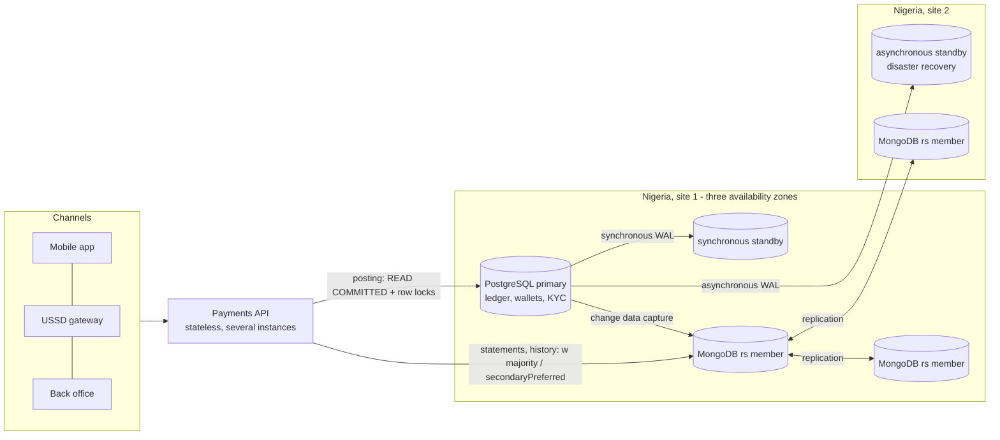

# Distributing OwoRail

One database server is a single point of failure, and it limits how far OwoRail can grow. This page sets out how I would distribute OwoRail's data and run it in the cloud. Every claim that can be tested on one machine was tested on the two clusters in this portfolio: a three-node replica set and a small sharded cluster ([setup.md](setup.md)). The figures below come from [m10_replication.txt](evidence/m10_replication.txt) and [m10_sharding.txt](evidence/m10_sharding.txt).

## What has to be true

| Requirement | Target | Why |
|---|---|---|
| A committed payment is never lost | RPO = 0 for the ledger | money; BR-13, BR-14 |
| Payments keep working when a server fails | failover within seconds, no manual step | customers pay merchants all day; USSD sessions time out |
| A balance is never read stale *when posting* | strong consistency for the posting path | a stale balance lets a customer overspend |
| Statements can be a few seconds behind | eventual consistency for app history | it's a display, not a decision |
| Personal and financial data stay under Nigerian control | primary copies hosted in Nigeria | NDPA 2023, and the central bank's expectations for payment operators |

## Architecture

- **PostgreSQL stays the system of record** for money, as argued in Portfolio 4. It has one primary, a **synchronous** standby in another availability zone of the same site (no committed transaction is lost if the primary fails), and an **asynchronous** standby at a second site for disaster recovery.
- **MongoDB is the read model** for statements and transaction history, fed from PostgreSQL by change data capture (Portfolio 4's loader is a batch version of that feed). It runs as a replica set of three members: two at site 1 and one at site 2. With that split, losing site 2 leaves a majority, and losing one zone at site 1 also leaves a majority.

## Fragmentation and allocation

| Data | Fragmentation | Allocation and replication | Consistency |
|---|---|---|---|
| wallets, transactions, ledger, status history | horizontal, by wallet (hash), when sharding is needed (below); ledger lines and history go with their transaction (derived fragmentation) | full copy on the synchronous standby; asynchronous copy at site 2 | **strong**: one primary, synchronous commit to the standby |
| KYC identity data | already split off vertically in Portfolio 1 (`kyc_profile`) | same servers, encrypted columns, access only for the compliance role | strong |
| tiers, fee rules, merchants | none: small, rarely changed | replicated to every node and shard | strong at the source; caches may lag seconds |
| audit log | none (append-only) | written with the posting, replicated like the ledger | strong |
| statements / history read model | by wallet (hashed), when it outgrows one replica set | MongoDB replica set across both sites | **eventual**: a few seconds behind PostgreSQL is acceptable |

## Replication: what was measured

| Scenario | Result |
|---|---|
| A write on the primary reached both secondaries | median about 17 ms on this laptop; the secondaries pull the operations from the primary's **oplog** (an entry `op: i, ns: owr.transactions` was read back on a secondary) |
| Cost of the write concern | `w: 1` median 17 ms; `w: majority` 49 ms; waiting for more members costs more. All members share one disk and CPU here, so the absolute numbers vary between runs; across sites the difference would be the network round trip |
| **Failover**: the primary was killed (SIGKILL) while a client kept writing with `w: majority` | a secondary was elected and writes paused for 11.4 s at most; the application saw **no errors**, because the driver held the write and retried it on the new primary; all 441 acknowledged writes were present afterwards |
| The old primary was restarted | it rejoined as a secondary after 6.4 s and caught up from the oplog; having the highest priority, it took back the primary role 12 s later |

The pause is set by the configuration: an election starts once a secondary has missed heartbeats for `electionTimeoutMillis` (10 s by default), and an election takes a few seconds on top. A shorter timeout fails over faster, but risks needless elections on a slow network. For a payment operator I'd keep about 10 s, and make sure the API's timeouts and the USSD session are longer than that.

## Consistency: what can go wrong, and the settings that prevent it

| Scenario | What happened | Setting that matters |
|---|---|---|
| **A w:1 write is lost.** The primary was cut off from both secondaries and acknowledged write A with `w: 1`. The secondaries then elected a new primary, which took write C. When the old primary returned, it **rolled back** A and wrote it to a rollback file. | A, which the client was told had succeeded, is gone from the database | `w: majority`: write B, made in the same situation with `w: majority`, failed with `WTimeoutError`, so the client knew it wasn't durable |
| **Stale read.** A secondary stopped applying the oplog (as a badly lagging one would). A balance written with `w: majority` was missing when read from that secondary, and present on the primary. | a read from a secondary can be behind | `readPreference: primary` (or majority reads) for anything a decision depends on |
| **Read your own writes.** 50 updates, each read back from a secondary in a causally consistent session. | 0 stale reads | `causalConsistency` sessions, with majority read and write concern |

The rules for OwoRail follow from these results:

1. **Postings:** `w: majority` (in PostgreSQL, `synchronous_commit` to the standby). An acknowledged payment must survive any single failure.
2. **Balance checks before posting:** read from the primary, under the row lock, as Portfolio 3 does.
3. **Statements and history:** read from secondaries, which is cheaper and spreads the load, inside a causal session, so a customer always sees the payment they just made.

## CAP and PACELC

When a network partition splits the cluster, OwoRail has to choose between consistency and availability. **For the ledger it chooses consistency.** Only the side holding a majority can elect a primary and accept postings; the minority side refuses them. The rollback scenario shows why: the cut-off primary's `w: 1` write was thrown away once the partition healed. Accepting payments on both sides would mean losing or duplicating money.

When there is no partition, the trade-off is latency against consistency (the "ELC" in PACELC). The ledger accepts the extra round trip of a majority or synchronous commit. The statement read model accepts reading slightly stale data from a nearby secondary in return for speed. It is the "available" part of the system, and nothing is decided from it.

## Sharding

One PostgreSQL primary handles OwoRail's current volume. Portfolio 2's workload ran on 1.1 million transactions without sharding, and vertical scaling plus read replicas go a long way. Sharding becomes necessary once writes outgrow one primary. These are the choices, tested on the sharded cluster:

| Shard key | Result in the cluster | Verdict |
|---|---|---|
| `created_at` (range) | data from May to October split well across the shards, but **all 10,000 new writes went to one shard** (0 and 10,000): the newest range is always on one shard, so it takes every insert | **rejected**: a hot spot |
| `source.wallet` (hashed) | 200,000 transactions split 99,490 and 100,510; new writes split 4,928 and 5,072; a query for one wallet's payments went to **one shard** (`SINGLE_SHARD`) | **chosen** |

The hashed wallet key comes with costs I'd plan for:

- **Queries without the shard key go to every shard.** A wallet's *incoming* payments and a "one day" report were both sent to both shards (`SHARD_MERGE`). The fix for statements is to store one entry per wallet, keyed by that wallet (a ledger-entries collection sharded by `wallet`). Then a statement is a single-shard query, whichever side of the payment the wallet was on. Reports become scheduled scatter-gather jobs or read from an analytics copy.
- **Most transfers cross shards.** The two wallets of a transfer usually hash to different shards, so posting needs a distributed transaction (two-phase commit inside MongoDB, or Citus for PostgreSQL). That is slower and is the main reason to postpone sharding.
- **Hot keys are not removed by hashing.** The single FEES wallet (Portfolio 3) and the busiest merchants would each still be one key on one shard. The FEES wallet should be split into several sub-wallets.
- **A shard outage is a partial outage.** With one shard stopped, a query for a wallet on the healthy shard still answered, and a full count failed. A scan with `allowPartialResults` returned 104,418 documents, the healthy shard's half. In production each shard is itself a replica set, so a shard outage should only come from losing a whole site.

## Deployment

| Option | For OwoRail |
|---|---|
| Fully managed database service (cloud PostgreSQL, MongoDB Atlas) | the least operational work, with backups, failover and patching built in. It's usable only where the provider can host and back up the data inside Nigeria, or where a transfer abroad has a lawful basis under NDPA 2023 |
| Self-managed on cloud VMs or in a Nigerian data centre | full control over where the data is. OwoRail then runs replication, failover (e.g. Patroni for PostgreSQL), backups and upgrades itself |
| **Recommended** | PostgreSQL and MongoDB on infrastructure located in Nigeria, across two sites, managed with automation. A managed service is the better choice only if a provider offers in-country hosting that meets the regulator's requirements; I'd confirm the current rules with compliance before choosing |

Whatever the hosting, production needs things this local setup doesn't have:

- TLS between all members and clients (the clusters here use only keyfile authentication, on localhost);
- encryption at rest;
- daily backups with point-in-time recovery, tested by restoring them (NFR-09);
- monitoring of replication lag and elections;
- one role per application, as in Portfolio 1.

## What this portfolio does and doesn't show

The clusters run on one laptop. They show the *mechanisms* (oplog replication, elections, rollback of unreplicated writes, causal sessions, shard targeting, hot spots and partial outages) faithfully. The *timings* are those of containers sharing one disk, with no real network between them. The failover pause depends mostly on the election timeout, so it would be similar in production. The replication lag and write-concern costs would not be.

## References

Abadi, D. (2012). Consistency tradeoffs in modern distributed database system design: CAP is only part of the story. *Computer, 45*(2), 37–42.

MongoDB, Inc. (n.d.). *MongoDB manual 7.0: Replication; Sharding; Read concern; Write concern; Causal consistency*. Retrieved November 11, 2026, from https://www.mongodb.com/docs/v7.0/

Özsu, M. T., & Valduriez, P. (2020). *Principles of distributed database systems* (4th ed.). Springer.
